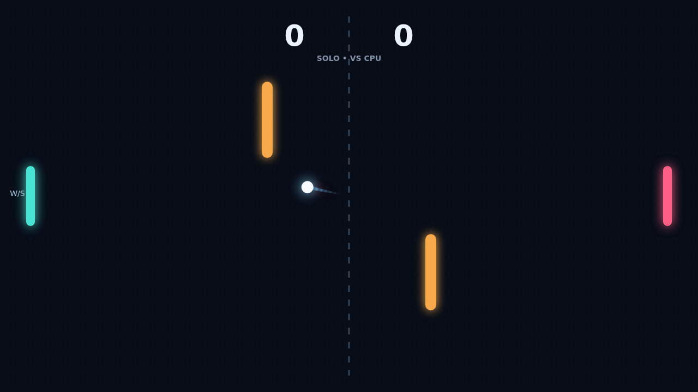

Carom opens with a ball held at center and both paddles ready. Choose Solo to face the computer or Versus to share the keyboard, then meet the serve and keep the rally alive.

Every return changes the angle according to where it meets your paddle. Move as the ball arrives and your paddle adds spin, bending its flight after contact. A clean center hit stays direct; a late swipe can send a surprising curve.

Two amber gates divide the open field. They turn straightforward returns into bank shots, reward reading the curve, and give a rally room to change direction. Walls and paddle edges keep the ball in play until it slips past a paddle.

Reach eleven points and lead by two to take the match. At ten-all, each return matters: shape the shot, find a route around the gates, and make the final opening count.

